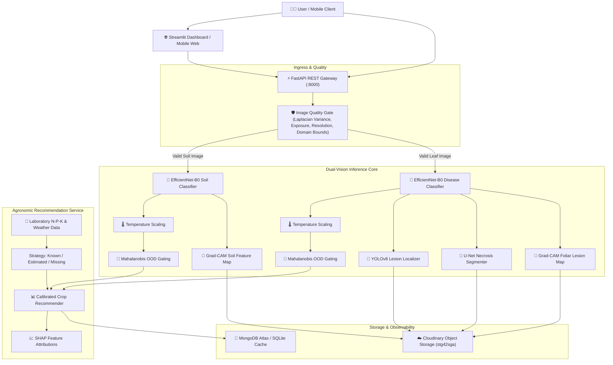

# EDAPHNET System Architecture Document

## 1. Executive Summary & Design Principles

**EDAPHNET** is an enterprise-grade Smart Agriculture Intelligence Platform designed to deliver multi-modal diagnostic intelligence directly to agronomists, farmers, and automated agricultural machinery.

The architecture adheres strictly to:
- **Clean Architecture & Separation of Concerns**: Core domain rules and mathematical models are completely decoupled from framework plumbing, transport protocols, and database engines.
- **SOLID Design Principles**: Every module has a single responsibility, interfaces are focused, and high-level business policies do not depend on low-level detail.
- **Calibrated Uncertainty Propagation**: Softmax confidence is never conflated with true epistemic certainty; temperature scaling and Mahalanobis out-of-distribution (OOD) distance govern decision thresholds.
- **Explainability as a First-Class Citizen**: High-stakes decisions are backed by visual Grad-CAM activation maps and SHAP feature attribution drivers.

---

## 2. Multi-Tiered Architectural Topology

---

## 3. Subsystem Breakdown

### 3.1 Domain Layer (`src/edaphnet/domain/`)
- **Responsibility**: Pure data contracts, domain enumerations, and validation models (`InferenceRequest`, `InferenceResponse`, `ReliabilityReport`, `SoilPrediction`, `DiseasePrediction`, `CropRecommendation`).
- **Dependencies**: Pydantic only. Zero dependencies on web frameworks or databases.

### 3.2 Data & Quality Gate (`src/edaphnet/data/quality_gate.py`)
- **Responsibility**: Pre-inference optical analysis to intercept corrupted, blurry, underexposed, overexposed, or out-of-domain images before initiating neural network execution.
- **Metrics**: Discrete Laplacian variance, mean grayscale luminance, standard deviation contrast, and chromatic domain ratios.

### 3.3 ML Layer (`src/edaphnet/ml/`)
- **Soil Classification**: EfficientNet-B0 fine-tuned on agricultural topsoil taxonomy (Alluvial, Black, Clay, Red, Sandy, Loamy).
- **Disease Pathology**: EfficientNet-B0 diagnostic engine for common pathogens (Alternaria, Phytophthora, Erysiphe, Puccinia, Xanthomonas, TYLCV).
- **Localization**: YOLOv8/YOLO11 regression of lesion bounding boxes.
- **Segmentation**: U-Net architecture predicting damaged foliar surface area percentage.
- **Confidence Calibration**: Post-hoc temperature scaling via Negative Log-Likelihood (NLL) optimization with L-BFGS.
- **OOD Detection**: Mahalanobis distance calculation on 1280-dimensional latent embeddings against training class centroids with tied inverse covariance.

### 3.4 Recommendation Engine (`src/edaphnet/recommendation/engine.py`)
- **Responsibility**: Multi-parameter crop ranking evaluating N-P-K tolerances, optimum pH ranges, temperature envelopes, humidity bounds, and rainfall requirements.
- **Missing Data Strategy**: Explicitly classifies each agronomic feature as `KNOWN`, `MISSING`, `ESTIMATED`, `UNAVAILABLE`, or `INVALID`. Never silently substitutes default values without reporting telemetry.
