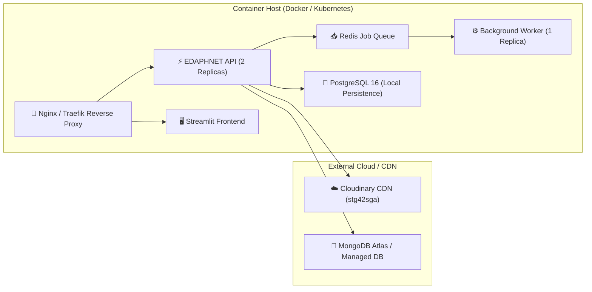

# EDAPHNET Deployment & Infrastructure Guide

## 1. Production Topology



---

## 2. Quickstart with Docker Compose

Ensure Docker and Docker Compose are installed, then run:

```bash
# 1. Clone repository & configure environment variables
cp .env.example .env

# 2. Build and launch all multi-container services
docker compose up -d --build

# 3. Check service health
docker compose ps
curl http://localhost:8000/health
```

### Services Port Mapping
- **API Gateway**: `http://localhost:8000`
- **Streamlit Web Portal**: `http://localhost:8501`
- **PostgreSQL**: `localhost:5432`
- **Redis**: `localhost:6379`

---

## 3. Local Bare-Metal Setup

```bash
# 1. Create and activate virtual environment
python -m venv .venv
source .venv/bin/activate  # Or on Windows: .\.venv\Scripts\activate

# 2. Install dependencies
pip install -r requirements.txt

# 3. Run FastAPI gateway
uvicorn apps.api.main:app --host 0.0.0.0 --port 8000 --reload

# 4. In a separate terminal, launch the Streamlit frontend
streamlit run apps/web/app.py --server.port 8501
```
