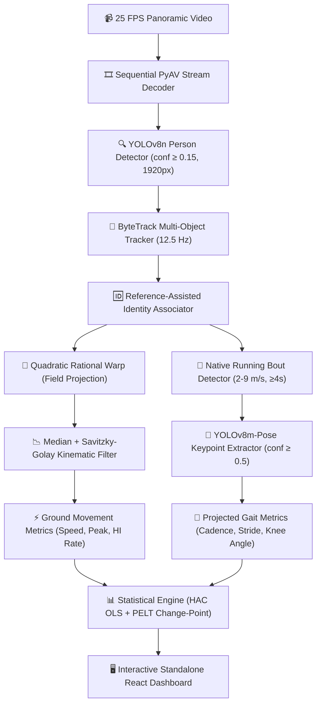

# ⚽ Player Fatigue Detection: Movement & Gait Analysis with Pretrained Vision Models

[](#)
[](https://python.org)
[](https://pytorch.org)
[](https://docs.ultralytics.com)
[](https://github.com/roboflow/supervision)
[](https://react.dev)
[](#)

> **Academic Project Report & Implementation**  
> **Course**: BCSE407L Computer Vision  
> **Authors**:
> * **S Srutan** (`23BCE2363`)
> * **Pranjal Sapkota** (`23BCE2332`)
> * **Shamvreuth** (`23BCE0692`)  
> **Repository**: [github.com/srutan2004/Player-Fatigue-Detection](https://github.com/srutan2004/Player-Fatigue-Detection)

---

## 📑 Table of Contents

1. [Executive Summary](#1-executive-summary)
2. [Introduction and Project Objectives](#2-introduction-and-project-objectives)
3. [Dataset and Study Design](#3-dataset-and-study-design)
4. [System Architecture and Model Roles](#4-system-architecture-and-model-roles)
5. [Detector Experiment and Data Partitioning](#5-detector-experiment-and-data-partitioning)
6. [Field Calibration and Ground Coordinates](#6-field-calibration-and-ground-coordinates)
7. [Tracking Identity and Source Timing](#7-tracking-identity-and-source-timing)
8. [Pose Extraction and Native Running Passages](#8-pose-extraction-and-native-running-passages)
9. [Ground Movement Feature Engineering](#9-ground-movement-feature-engineering)
10. [Projected Gait Feature Engineering](#10-projected-gait-feature-engineering)
11. [Baselines Regression and Statistical Design](#11-baselines-regression-and-statistical-design)
12. [Change Point Search and Robustness](#12-change-point-search-and-robustness)
13. [Study Coverage and Processing Results](#13-study-coverage-and-processing-results)
14. [Qualified Early and Late Movement Comparison](#14-qualified-early-and-late-movement-comparison)
15. [Movement Trajectories over Match Time](#15-movement-trajectories-over-match-time)
16. [Running Distribution and Period Summaries](#16-running-distribution-and-period-summaries)
17. [Accepted Gait Cycle Results](#17-accepted-gait-cycle-results)
18. [Projected Mechanics and Comparable Running](#18-projected-mechanics-and-comparable-running)
19. [Regression and Temporal Analysis Results](#19-regression-and-temporal-analysis-results)
20. [Independent Broadcast Evaluation](#20-independent-broadcast-evaluation)
21. [React Dashboard Overview and Navigation](#21-react-dashboard-overview-and-navigation)
22. [Dashboard Interactions Themes and Exports](#22-dashboard-interactions-themes-and-exports)
23. [Software Implementation and Verification](#23-software-implementation-and-verification)
24. [Running and Reproducing the Project](#24-running-and-reproducing-the-project)
25. [Conclusion and Interpretation](#25-conclusion-and-interpretation)
26. [References and Evidence Sources](#26-references-and-evidence-sources)
* [Appendices (Primary Movement Windows & Artifacts)](#appendices)

---

## 1. Executive Summary

This project implements a complete, transparent Python workflow for measuring association football player movement and investigating fatigue-related changes directly from video streams without wearable sensors. 

Pretrained **YOLOv8n** detects players, **ByteTrack** constructs continuous tracklets, and reference-assisted association maintains longitudinal identities. An empirically validated quadratic rational mapping projects pixel anchors into metric pitch coordinates $(X, Y \in \text{meters})$. During steady-state running passages, pretrained **YOLOv8m-Pose** estimates 17 anatomical keypoints, enabling projected gait periodicity features alongside macro ground movement metrics.

```
       100 Minutes Footage  │  3 Selected Outfield Players  │  2 Matches
  225,000 Target Frames    │  72 Non-Overlapping Windows   │  63 Validated Gait Cycles
```

### Table 1: Principal Measured Results

| Measured Outcome | Recorded Result | Method / Context |
|---|---|---|
| **Held-out Detector Precision** | **94.68%** | Match 128057 (IoU $\ge 0.50$) |
| **Held-out Detector Recall** | **89.98%** | Match 128057 (IoU $\ge 0.50$) |
| **Held-out Detector mAP@0.50** | **93.10%** | Pretrained weights on held-out match |
| **Held-out Detector mAP@0.50:0.95** | **72.32%** | Validation-selected final model |
| **Field-Reference Median Error (Match A)** | **0.654 m** | 13 withheld survey markers |
| **Field-Reference Median Error (Match B)** | **0.615 m** | 13 withheld survey markers |
| **Blue 36 Average Speed Change** | **-12.5%** | Early ($2.207\,\text{m/s}$) vs. Late ($1.930\,\text{m/s}$) |
| **Blue 36 Sustained Peak Speed Change** | **-10.2%** | Early ($6.538\,\text{m/s}$) vs. Late ($5.873\,\text{m/s}$) |
| **Blue 36 High-Intensity Rate Change** | **-37.0%** | Early ($17.698$) vs. Late ($11.142\,\text{m/min}$) |
| **Broadcast Labeled-Player Recall** | **90.03%** | 3,178 of 3,530 boxes across 300 SoccerNet frames |
| **Dashboard Verification** | **34/34 Checks** | Zero runtime errors, zero external web requests |

> **Key Research Finding**: The qualified longitudinal comparison demonstrates significant, quantifiable reductions in late-match movement intensity for player `A_blue_36`. The methodology treats this as an empirical movement finding relevant to fatigue investigation rather than an unverified physiological diagnosis.

---

## 2. Introduction and Project Objectives

### 2.1 Domain Background
Modern association football demands intermittent bouts of walking, jogging, submaximal cruising, and maximal sprints. As physical exertion accumulates over 90 minutes, physiological exhaustion alters both:
1. **Kinematic Work Capacity**: Reductions in total ground distance, peak velocity, and high-intensity sprint bursts.
2. **Biomechanical Gait Characteristics**: Degradations in stride mechanics, foot turnover cadence, knee flexion range of motion, and vertical center-of-mass control.

Traditional sports science relies on wearable GPS/IMU vests. However, wearables are intrusive, often prohibited in official lower-tier fixtures, prone to athlete non-compliance, and unavailable when analyzing historical footage or opponent broadcasts. Video provides a practical, non-invasive medium, but demands robust computer vision to transform uncalibrated pixels into metrically sound kinematics.

### 2.2 Implemented Objectives
* **Persistent Identity Tracking**: Detect athletes at high resolution while rigorously decoupling short-lived tracker IDs from longitudinal player identities.
* **Metric Field Projection**: Calibrate curved panoramic perspectives into true $105 \times 68\,\text{m}$ pitch coordinates using sub-meter validated rational mappings.
* **Confidence-Qualified Pose Extraction**: Isolate candidate straight-line running passages ($\ge 4\,\text{s}$, $2\text{--}9\,\text{m/s}$) and extract 17 keypoint anatomical poses with joint confidence filtering ($\ge 0.5$).
* **Physical & Gait Feature Engineering**:
  * *Ground Kinematics*: Average speed ($\text{m/s}$), sustained peak speed ($\text{m/s}$), running 90th percentile speed ($\text{m/s}$), and high-intensity distance rate ($\ge 5.5\,\text{m/s}$ in $\text{m/min}$).
  * *Projected Gait Mechanics*: Same-leg cadence ($\text{cycles/s}$), ground-path stride-length proxy ($\text{m/cycle}$), normalized vertical hip oscillation ratio, and projected knee flexion excursion ($\Delta \theta^\circ$).
* **Conservative Statistical Inference**: Normalize eligible metrics against player-specific early baselines, estimate Heteroskedasticity and Autocorrelation Consistent (HAC) trend slopes, and perform multi-resolution PELT change-point searches.
* **Interactive Decoupled Dashboard**: Provide an offline, serverless single-file React client with 6 analytical modules for interactive exploration, pitch playback, and raw metric export.

---

## 3. Dataset and Study Design

The primary longitudinal study is conducted on **SoccerTrack v2 (Release v1.2, Revision `325bd4c5`)**. Panoramic video is captured at **$4096 \times 1080$ resolution at 25 fps**.

### Table 2: Source Dataset Breakdown
| Downloaded Category | Size (GB) | Role in System |
|---|---|---|
| Four Panoramic Half Videos | 13.59 GB | ~184.05 minutes of primary video footage |
| Four Game-State Annotations | 11.06 GB | Contextual ground truth and player identities |
| Curated Tracking Clips & Labels | 0.61 GB | Detector development and tracking audit |
| Field Reference Assets | 0.03 GB | Surveyed camera calibration points |
| **Total Source Ingestion** | **25.29 GB** | Excludes model weights and derived caches |

### Table 3: Selected Continuous Study Segments (100 Minutes Total)
| Match & Half | Configured Match Time | Evaluated Players | Scheduled Player-Minutes |
|---|---|---|---|
| **117093 First Half** | `05:00` to `30:00` | `A_blue_36` | 25 min |
| **117093 Second Half** | `60:00` to `85:00` | `A_blue_36` | 25 min |
| **128057 First Half** | `05:00` to `30:00` | `B_white_9` & `B_white_17` | 50 min |
| **128057 Second Half** | `60:00` to `85:00` | `B_white_9` & `B_white_17` | 50 min |

*Supplementary Broadcast Generalization*: 5 test clips from **SoccerNet-GSR (2024)** (SNGS-116 to SNGS-120; 300 sampled frames, 3,530 labeled player boxes).

---

## 4. System Architecture and Model Roles



### Table 4: Component Responsibilities
| Component | Method / Architecture | Output Artifact |
|---|---|---|
| **Person Detection** | Pretrained `YOLOv8n` | Bounding boxes and detection confidences |
| **Temporal Association** | Supervision `ByteTrack` | Temporary tracklet histories |
| **Study Identity** | Global Linear Sum Assignment | Persistent target player links |
| **Field Coordinates** | Quadratic Rational Warp | Calibrated pitch coordinates $(X, Y)$ in meters |
| **Anatomical Pose** | Pretrained `YOLOv8m-Pose` | 17 keypoint pixel locations and joint confidences |
| **Time-Series Analysis** | `Statsmodels` OLS + `Ruptures` PELT | Trend slopes, 95% CIs, and change-point candidates |
| **Interactive Interface** | React + Plotly + CSS | Offline zero-dependency `dashboard.html` |

---

## 5. Detector Experiment and Data Partitioning

A controlled experiment evaluated whether fine-tuning the person detector on domain-specific football frames yielded superior detection over standard COCO-pretrained weights.

* **Data Splits**: 587 total frames (387 train, 100 val from Match 117093; 100 held-out test from Match 128057).
* **Training Settings**: YOLOv8n, 15 epochs, batch size 4, 10 frozen backbone layers, AdamW with AMP on NVIDIA RTX 4060 (elapsed time: 257.99 s).

### Table 7: Detector Evaluation Comparison
| Model Variant | Val mAP@0.50 | Val mAP@0.50:0.95 | Test mAP@0.50 | Test mAP@0.50:0.95 | Test Precision | Test Recall |
|---|---|---|---|---|---|---|
| **Pretrained YOLOv8n** | **95.31%** | **71.05%** | **93.10%** | **72.32%** | **94.68%** | **89.98%** |
| Adapted YOLOv8n | 95.11% | 68.03% | -- | -- | 93.29% | 90.19% |

> **Decision**: Pretrained YOLOv8n demonstrated superior validation mAP (0.7105 vs. 0.6803) and avoided overfitting. Stock COCO weights were retained for all longitudinal runs.

---

## 6. Field Calibration and Ground Coordinates

Curved wide-angle panoramic cameras induce severe optical distortion. The pipeline compares planar homography, affine, and quadratic rational warps against survey markers:

$$\begin{bmatrix} a \\ b \\ c \end{bmatrix} = \mathcal{H} \begin{bmatrix} u \\ v \\ 1 \end{bmatrix}, \quad X = \frac{a}{c}, \quad Y = \frac{b}{c}$$

### Table 8: Calibration Error on 13 Withheld Ground References
| Camera / Match | Fitted Model | Median Physical Error | 95th Percentile Error |
|---|---|---|---|
| **Match 117093** | Quadratic Rational Warp | **0.654 m** | 1.933 m |
| **Match 128057** | Quadratic Rational Warp | **0.615 m** | 2.101 m |

Player coordinates are anchored to the **center-bottom of the detected box**, providing ground-contact correspondence while keeping elevated hips reserved for gait geometry.

---

## 7. Tracking Identity and Source Timing

* **Temporal Alignment**: Video is decoded sequentially using `PyAV` to preserve native presentation timestamps (PTS), preventing frame-drop drift across multi-stream origins.
* **Association**: Updates run at 12.5 fps and map to a 25 fps output grid. Tracklet links are bounded to $0.8\,\text{s}$ memory under occlusion before tagging explicit gaps.
* **Raw Tracking Audit (Match 128057 without Identity Assistance)**:
  * 750 tracker updates on 16,500 annotated boxes.
  * Known-player box recall @ IoU 0.50: **79.39%**.
  * Identity switches across 12,593 matched pairs: **21 switches**.

---

## 8. Pose Extraction and Running Passages

To optimize GPU utilization, anatomical pose estimation is executed exclusively during qualified running passages:
* **Criteria**: Approximately straight running ($2\text{--}9\,\text{m/s}$), duration $\ge 4.0\,\text{s}$, player height $\ge 40\,\text{px}$, heading variation $\le 30^\circ$ over 2 seconds.
* **Model Selection Audit**:
  * `YOLOv8s-Pose`: Passed 6-joint confidence threshold on 173/255 crops (**67.84%**).
  * `YOLOv8m-Pose` (Selected): Passed 6-joint confidence threshold on 249/255 crops (**97.65%**).

---

## 9. Ground Movement Feature Engineering

Coordinates undergo a 3-point median filter and an approximately $0.8\,\text{s}$ Savitzky-Golay smoother (speeds $> 12\,\text{m/s}$ are flagged as unphysical artifacts).

### Table 11: Ground Metric Definitions
| Metric | Calculation | Physical Unit |
|---|---|---|
| **Average Speed** | Valid ground distance divided by valid observed time | $\text{m/s}$ |
| **Sustained Peak Speed** | Maximum supported rolling $1.0\,\text{s}$ window mean | $\text{m/s}$ |
| **Running Speed p90** | 90th percentile of finite running observations $\ge 2.0\,\text{m/s}$ | $\text{m/s}$ |
| **High-Intensity Distance Rate** | Distance covered at $\ge 5.5\,\text{m/s}$ normalized per minute | $\text{m/min}$ |

* **Windowing**: Primary inference uses non-overlapping **120-second windows** requiring $\ge 70\%$ valid exposure ($\ge 84\,\text{s}$). Display charts use overlapping 60-second steps.

---

## 10. Projected Gait Feature Engineering

Within running passages, cyclical ankle-to-hip displacements are detrended and processed via autocorrelation (or Lomb-Scargle for intermittent confidence drops):

$$\text{Leg Signal} = \frac{X_{\text{ankle}} - X_{\text{hip}}}{\text{Body Box Height}}, \quad \text{Cadence} = \frac{1}{\Delta t_{\text{consecutive landmarks}}}$$

### Table 12: Gait Metric Definitions
| Metric | Cycle Formulation | Unit |
|---|---|---|
| **Cadence** | Inverse duration between validated same-leg peaks | $\text{cycles/s}$ |
| **Stride-Length Proxy** | Calibrated pitch distance covered across one full cycle | $\text{m/cycle}$ |
| **Vertical Oscillation** | Normalized standard deviation of detrended hip height | Fraction of Body Height |
| **Knee Excursion** | 95th minus 5th percentile of projected knee flexion ($180^\circ - \angle \text{hip-knee-ankle}$) | Degrees ($\Delta \theta^\circ$) |

---

## 11. Baselines Regression and Statistical Design

* **Own-Player Normalization**: Metrics are normalized against the player's initial 10-minute early baseline (configured match minutes `05:00` to `15:00`):
  $$\text{Change from Baseline (\%)} = 100 \times \left( \frac{\text{Window Value}}{\text{Baseline}} - 1 \right)$$
* **Linear Trends**: Fitted via Ordinary Least Squares (OLS) with **lag-1 Newey-West HAC covariance**. Slopes are reported in baseline percentage points per minute ($\text{pp/min}$) with Holm-adjusted p-values.

---

## 12. Change Point Search and Robustness

To identify structural fatigue boundaries, the pipeline runs **PELT (Pruned Exact Linear Time)** with an $L_2$ cost function:
* **Inference Gates**: Requires $\ge 8$ contiguous qualified windows and a downward shift of at least $10\,\text{pp}$ and twice local noise scale.
* **Sensitivity Matrix**: 9 combinations of smoothing ($0.6, 0.8, 1.2\,\text{s}$) $\times$ window sizes ($120, 180, 240\,\text{s}$).
* **Empirical Outcome**: Candidate identified for `B_white_9` at `11:00` corroborated in only 2 of 6 assessable settings. Following conservative rules, **0 supported onset boundaries** were certified, preventing false positive claims.

---

## 13. Study Coverage and Processing Results

### Table 16: Exposure and Window Yield per Player-Period
| Player & Stream | Valid Obs Time (s) | Movement Coverage | 120s Windows Passed | Accepted Gait Cycles |
|---|---|---|---|---|
| **`A_blue_36` Early** | 1,174.48 s | 78.30% | 10 / 12 | 20 |
| **`A_blue_36` Late** | 1,235.24 s | 82.35% | 11 / 12 | 39 |
| **`B_white_17` Early** | 1,123.44 s | 74.90% | 9 / 12 | 4 |
| **`B_white_17` Late** | 857.40 s | 57.16% | 2 / 12 | 0 |
| **`B_white_9` Early** | 1,263.36 s | 84.22% | 12 / 12 | 0 |
| **`B_white_9` Late** | 351.80 s | 23.45% | 0 / 12 | 0 |
| **Total Cohort** | **6,005.72 s** | -- | **44 / 72** | **63** |

---

## 14. Qualified Early and Late Movement Comparison

Player `A_blue_36` provides complete qualified coverage across both halves, revealing clear fatigue-correlated movement decline.

### Table 18: Qualified Blue 36 Kinematic Summary
| Metric | Early Period Mean | Late Period Mean | Absolute Difference | Relative Change |
|---|---|---|---|---|
| **Average Ground Speed** | $2.207\,\text{m/s}$ | $1.930\,\text{m/s}$ | $-0.277\,\text{m/s}$ | **-12.5%** |
| **Sustained Peak Speed** | $6.538\,\text{m/s}$ | $5.873\,\text{m/s}$ | $-0.665\,\text{m/s}$ | **-10.2%** |
| **Running Speed p90** | $5.609\,\text{m/s}$ | $5.287\,\text{m/s}$ | $-0.322\,\text{m/s}$ | **-5.8%** |
| **High-Intensity Distance Rate** | $17.698\,\text{m/min}$ | $11.142\,\text{m/min}$ | $-6.556\,\text{m/min}$ | **-37.0%** |

---

## 17. Accepted Gait Cycle Results

### Table 19: Descriptive Gait Cycle Distributions (Median [IQR])
| Player Period | Valid Cycles ($n$) | Cadence ($\text{cyc/s}$) | Stride Proxy ($\text{m}$) | Vertical Ratio | Knee Excursion ($\Delta \theta^\circ$) |
|---|---|---|---|---|---|
| **`A_blue_36` Early** | 20 | 1.471 [1.450, 1.667] | 2.448 [2.243, 2.693] | 0.022 [0.019, 0.028] | $14.95^\circ$ [9.71, 26.30] |
| **`A_blue_36` Late** | 39 | 1.667 [1.562, 1.667] | 2.887 [2.703, 3.069] | 0.024 [0.022, 0.028] | $50.03^\circ$ [43.90, 60.67] |
| **`B_white_17` Early** | 4 | 1.476 [1.389, 1.589] | 2.229 [2.141, 2.433] | 0.020 [0.017, 0.020] | $11.87^\circ$ [11.79, 12.11] |

---

## 19. Regression and Temporal Analysis Results

### Table 20: White 9 Normalized Movement Trends
| Metric | Trend Slope ($\text{pp/min}$) | 95% Confidence Interval | Raw $p$-value | Holm Adjusted $p$-value |
|---|---|---|---|---|
| **Average Speed** | $-0.482\,\text{pp/min}$ | $[-1.593, +0.628]$ | 0.395 | 1.000 |
| **Sustained Peak** | $+0.166\,\text{pp/min}$ | $[-1.315, +1.646]$ | 0.827 | 1.000 |
| **Running p90** | $-0.031\,\text{pp/min}$ | $[-1.233, +1.172]$ | 0.960 | 1.000 |
| **High-Intensity Rate** | $+0.823\,\text{pp/min}$ | $[-6.458, +8.105]$ | 0.825 | 1.000 |

*Result*: All 95% confidence intervals cross zero with Holm-adjusted $p = 1.000$, indicating no statistically significant uniform linear decay during that isolated passage.

---

## 20. Independent Broadcast Evaluation

Evaluated across 5 separate SoccerNet-GSR public broadcast clips ($60\,\text{frames/clip} = 300\,\text{frames}$ total):

### Table 22: Broadcast Generalization Audit
| Clip ID | Frames | Labeled Boxes | Matched Boxes | Player Recall (@ IoU $\ge 0.50$) | 6-Joint Pose Pass Rate |
|---|---|---|---|---|---|
| **SNGS-116** | 60 | 814 | 694 | 85.26% | 19 / 20 crops |
| **SNGS-117** | 60 | 606 | 556 | 91.75% | 20 / 20 crops |
| **SNGS-118** | 60 | 752 | 661 | 87.90% | 20 / 20 crops |
| **SNGS-119** | 60 | 564 | 531 | 94.15% | 20 / 20 crops |
| **SNGS-120** | 60 | 794 | 736 | 92.70% | 19 / 20 crops |
| **Pooled Total** | **300** | **3,530** | **3,178** | **90.03%** | **98 / 100 crops (98.0%)** |

---

## 21. React Interactive Dashboard

The results are compiled into a standalone, single-file HTML application (`results/phase4/dashboard.html`) requiring no backend or local server.

```
┌────────────────────────────────────────────────────────────────────────┐
│  ⚽ PLAYER FATIGUE DASHBOARD                       [Light/Dark] [Export]│
├─────────────────┬──────────────────────────────────────────────────────┤
│ 1. Overview     │ • Player & Period Switcher                           │
│ 2. Movement     │ • 8 Metric Panels (Physical vs Baseline %)           │
│ 3. Gait Explorer│ • Accepted Cycles, Scatterplot Cadence vs Speed      │
│ 4. Pitch Map    │ • Minimap Scrubbing, 2D Trajectories, Occupancy Heat │
│ 5. Evaluation   │ • Precision/Recall Curves, Calibration Residuals     │
│ 6. Study Scope  │ • Pipeline Manifest, Model Hashes, Full Audit Logs   │
└─────────────────┴──────────────────────────────────────────────────────┘
```

---

## 23. Software Verification & Quality Assurance

### Table 25: Verification Suite
| Verification Target | Test Suite | Outcome |
|---|---|---|
| **Python Automated Tests** | Unit tests covering PTS offsets, homography warps, Savitzky-Golay bounds | **33 Passed** |
| **Synthetic Change-Point Controls** | Artificial step functions and stationary noise sequences | **3/3 Passed** |
| **Interactive Dashboard QA** | Playwright headless browser check verifying exports and DOM states | **34 Passed** |
| **End-to-End Notebook** | Execution of all 10 analysis cells across an 18-cell notebook | **100% Executed** |
| **Annotated Video Verification** | Continuous 250-frame source-aligned video with HUD overlays | **Verified** |

---

## 24. Running and Reproducing the Project

### System Prerequisites
* **OS**: Linux, Windows 11, or macOS.
* **Hardware**: Tested on AMD Ryzen 7 7840HS, 16 GB RAM, NVIDIA RTX 4060 Laptop GPU (8 GB VRAM).
* **Python**: `3.12` with PyTorch `2.8.0` + CUDA support.

### Step 1: Environment Setup
```bash
# Clone the repository
git clone https://github.com/srutan2004/Player-Fatigue-Detection.git
cd Player-Fatigue-Detection

# Install locked dependencies using uv
uv sync --locked --group dev --group notebook

# Run smoke test on vision models
uv run --no-sync python -m src.cli check-environment --smoke-models
```

### Step 2: Running Analysis & Generating Artifacts
```bash
# Execute tracking and metric extraction
uv run --no-sync python scripts/run_study.py

# Finalize Phase 3 feature engineering
uv run --no-sync python scripts/finalize_phase3.py

# Perform statistical analysis (HAC OLS & PELT)
uv run --no-sync python -m src.cli analyze
```

### Step 3: Launching the Dashboard
```bash
# Option A: Open directly in your browser
Start-Process '.\results\phase4\dashboard.html'    # Windows PowerShell
open ./results/phase4/dashboard.html             # macOS
xdg-open ./results/phase4/dashboard.html         # Linux

# Option B: Rebuild frontend client from source
npm --prefix dashboard ci
npm --prefix dashboard run build
uv run --no-sync python scripts/render_dashboard.py
```

---

## 25. Conclusion and Interpretation

1. **Integrated Framework**: Demonstrated an end-to-end computer vision pipeline that pairs commodity pretrained models (`YOLOv8n`, `YOLOv8m-Pose`) with geometric field calibration and time-series feature engineering.
2. **Empirical Findings**: Player `A_blue_36` exhibited a clear **$-12.5\%$ decline in average speed** and a **$-37.0\%$ drop in high-intensity distance rate** between early and late match segments.
3. **Statistical Integrity**: By enforcing exposure thresholds and abstention gates, the system avoids generating false positive fatigue boundaries when data coverage is insufficient.

---

## 26. References and Evidence Sources

1. **SoccerTrack v2 Dataset**: [HuggingFace atomscott/soccertrack-v2](https://huggingface.co/datasets/atomscott/soccertrack-v2) (Revision `325bd4c5`).
2. **SoccerNet-GSR (2024)**: [HuggingFace SoccerNet/SN-GSR-2024](https://huggingface.co/datasets/SoccerNet/SN-GSR-2024) (Revision `3cc710eb`).
3. **Ultralytics YOLOv8**: Jocher et al., [docs.ultralytics.com](https://docs.ultralytics.com/models/yolov8/).
4. **ByteTrack**: Zhang et al., *"ByteTrack: Multi-Object Tracking by Associating Every Detection Box"*, ECCV 2022.
5. **Ruptures Change-Point Detection**: Truong et al., *"Selective Review of Offline Change Point Detection Methods"*, Signal Processing 2020.
6. **Statsmodels**: Seabold & Perktold, *"Statsmodels: Econometric and Statistical Modeling with Python"*, SciPy 2010.

---

## Appendices

<details>
<summary><b>Appendix A: Primary Movement Windows — A_blue_36</b></summary>

### A_blue_36 Early Period (First Half `05:00–29:00`)
| Match Interval | Valid Coverage | Average Speed ($\text{m/s}$) | Peak Speed ($\text{m/s}$) | Run p90 ($\text{m/s}$) | HI Rate ($\text{m/min}$) |
|---|---|---|---|---|---|
| `05:00 to 07:00` | 83.5% | 1.92 | 6.38 | 4.74 | 8.15 |
| `07:00 to 09:00` | 77.8% | 1.95 | 6.81 | 6.07 | 20.80 |
| `09:00 to 11:00` | 84.3% | 2.24 | 5.59 | 4.85 | 4.69 |
| `11:00 to 13:00` | 79.3% | 2.34 | 6.16 | 5.19 | 15.36 |
| `13:00 to 15:00` | 63.6% | -- | -- | -- | -- |
| `15:00 to 17:00` | 89.4% | 2.44 | 6.46 | 6.00 | 33.74 |
| `17:00 to 19:00` | 86.6% | 2.01 | 7.63 | 6.42 | 22.99 |
| `19:00 to 21:00` | 74.3% | 2.39 | 5.52 | 5.16 | 12.50 |
| `21:00 to 23:00` | 76.2% | 2.29 | 8.05 | 7.01 | 28.73 |
| `23:00 to 25:00` | 82.4% | 2.17 | 6.76 | 5.24 | 13.51 |
| `25:00 to 27:00` | 66.2% | -- | -- | -- | -- |
| `27:00 to 29:00` | 71.5% | 2.35 | 5.93 | 5.41 | 15.39 |

### A_blue_36 Late Period (Second Half `60:00–84:00`)
| Match Interval | Valid Coverage | Average Speed ($\text{m/s}$) | Peak Speed ($\text{m/s}$) | Run p90 ($\text{m/s}$) | HI Rate ($\text{m/min}$) |
|---|---|---|---|---|---|
| `60:00 to 62:00` | 63.6% | -- | -- | -- | -- |
| `62:00 to 64:00` | 79.1% | 1.92 | 5.19 | 4.58 | 3.69 |
| `64:00 to 66:00` | 91.8% | 1.51 | 5.25 | 5.14 | 1.25 |
| `66:00 to 68:00` | 91.8% | 2.41 | 6.91 | 5.89 | 24.84 |
| `68:00 to 70:00` | 77.9% | 1.91 | 5.91 | 5.12 | 8.90 |
| `70:00 to 72:00` | 86.3% | 1.91 | 6.03 | 5.59 | 12.50 |
| `72:00 to 74:00` | 80.0% | 1.75 | 4.75 | 5.11 | 9.26 |
| `74:00 to 76:00` | 86.5% | 2.40 | 6.38 | 5.88 | 27.15 |
| `76:00 to 78:00` | 85.8% | 2.27 | 6.98 | 5.06 | 13.95 |
| `78:00 to 80:00` | 86.6% | 1.80 | 5.29 | 4.64 | 2.68 |
| `80:00 to 82:00` | 82.0% | 2.06 | 5.37 | 5.02 | 5.42 |
| `82:00 to 84:00` | 81.0% | 1.24 | 6.39 | 6.02 | 11.43 |

</details>

<details>
<summary><b>Appendix B: Primary Movement Windows — B_white_17</b></summary>

### B_white_17 Early Period (`05:00–29:00`)
| Match Interval | Valid Coverage | Average Speed ($\text{m/s}$) | Peak Speed ($\text{m/s}$) | Run p90 ($\text{m/s}$) | HI Rate ($\text{m/min}$) |
|---|---|---|---|---|---|
| `05:00 to 07:00` | 38.3% | -- | -- | -- | -- |
| `07:00 to 09:00` | 57.8% | -- | -- | -- | -- |
| `09:00 to 11:00` | 87.5% | 2.64 | 6.65 | 5.83 | 26.60 |
| `11:00 to 13:00` | 51.6% | -- | -- | -- | -- |
| `13:00 to 15:00` | 81.6% | 2.54 | 6.55 | 5.49 | 18.59 |
| `15:00 to 17:00` | 79.6% | 2.51 | 5.92 | 5.05 | 11.76 |
| `17:00 to 19:00` | 88.1% | 2.12 | 8.00 | 5.13 | 13.55 |
| `19:00 to 21:00` | 82.6% | 2.76 | 7.33 | 5.47 | 24.54 |
| `21:00 to 23:00` | 77.3% | 2.05 | 6.32 | 5.33 | 13.70 |
| `23:00 to 25:00` | 84.3% | 2.07 | 6.17 | 5.51 | 15.56 |
| `25:00 to 27:00` | 90.2% | 1.71 | 6.02 | 4.76 | 6.57 |
| `27:00 to 29:00` | 77.7% | 2.39 | 8.34 | 6.63 | 31.36 |

### B_white_17 Late Period (`60:00–84:00`)
| Match Interval | Valid Coverage | Average Speed ($\text{m/s}$) | Peak Speed ($\text{m/s}$) | Run p90 ($\text{m/s}$) | HI Rate ($\text{m/min}$) |
|---|---|---|---|---|---|
| `68:00 to 70:00` | 73.7% | 2.01 | 5.64 | 5.40 | 13.85 |
| `76:00 to 78:00` | 73.5% | 2.04 | 5.91 | 4.56 | 7.31 |
| *Other Windows* | $< 70\%$ | -- | -- | -- | -- |

</details>

<details>
<summary><b>Appendix C: Primary Movement Windows — B_white_9</b></summary>

### B_white_9 Early Period (`05:00–29:00`)
| Match Interval | Valid Coverage | Average Speed ($\text{m/s}$) | Peak Speed ($\text{m/s}$) | Run p90 ($\text{m/s}$) | HI Rate ($\text{m/min}$) |
|---|---|---|---|---|---|
| `05:00 to 07:00` | 71.7% | 2.32 | 6.59 | 5.55 | 19.32 |
| `07:00 to 09:00` | 77.8% | 2.54 | 7.13 | 5.27 | 15.96 |
| `09:00 to 11:00` | 84.3% | 2.52 | 7.10 | 6.52 | 36.35 |
| `11:00 to 13:00` | 78.1% | 1.77 | 4.97 | 5.22 | 9.22 |
| `13:00 to 15:00` | 76.5% | 2.09 | 5.97 | 4.45 | 6.61 |
| `15:00 to 17:00` | 83.9% | 2.12 | 6.89 | 6.52 | 27.97 |
| `17:00 to 19:00` | 94.4% | 1.80 | 5.36 | 4.22 | 2.39 |
| `19:00 to 21:00` | 95.0% | 2.12 | 6.02 | 4.60 | 5.02 |
| `21:00 to 23:00` | 87.2% | 1.96 | 4.67 | 4.55 | 5.54 |
| `23:00 to 25:00` | 85.0% | 1.99 | 6.63 | 5.39 | 14.69 |
| `25:00 to 27:00` | 87.7% | 1.85 | 6.08 | 4.91 | 7.55 |
| `27:00 to 29:00` | 88.5% | 2.59 | 8.56 | 6.95 | 52.03 |

</details>

---

## 👥 Authors & Academic Context

* **S Srutan** — `23BCE2363`
* **Pranjal Sapkota** — `23BCE2332`
* **Shamvreuth** — `23BCE0692`

**Institution Course**: BCSE407L Computer Vision  
**Full Code & Asset Pipeline**: [github.com/srutan2004/Player-Fatigue-Detection](https://github.com/srutan2004/Player-Fatigue-Detection)
